# agent-toolkit

A collection of generic agentic tools for common engineering tasks, designed to work with any AI
agent on any kind of software project. The philosophy behind the toolkit — five pillars and a
litmus test for every new artifact — is captured in
[docs/core-philosophy.md](./docs/core-philosophy.md).

## Skills

Agentic skills for everyday software engineering — solo or in a team, not bound to any specific
language or framework.

### Skill & doc authoring

Tools to create and continuously improve the skills and docs your agents rely on, following
[this approach to agentic skills](https://medium.com/engineering-in-the-age-of-ai/my-approach-to-agentic-skills-e08dc6c0d1cd).

- **[compact-docs-writer](./skills/compact-docs-writer/SKILL.md)** — write docs with maximum token
  economy.
- **[compact-skill-creator](./skills/compact-skill-creator/SKILL.md)** — create or edit skills,
  keeping them lean and efficient.
- **[self-improve](./skills/self-improve/SKILL.md)** — capture a lesson into the skill, doc or check
  that governs it, so mistakes aren't repeated and agents keep getting better at the project.

### Context & memory hygiene

Maintenance to run from time to time, keeping your setup tidy and your context sharp.

- **[agentify-project](./skills/agentify-project/SKILL.md)** — make a project agent-ready by
  converging it toward a canonical agent-neutral structure (a lean AGENTS.md index with
  progressive disclosure, shared skills, gitignore hygiene). Re-runnable, and doubles as an audit.
- **[context-checkup](./skills/context-checkup/SKILL.md)** — audit what auto-loads into a
  session's context and spot what can be trimmed to reduce startup tokens.
  [Why this is important](https://medium.com/engineering-in-the-age-of-ai/keep-your-ai-agents-context-window-sharp-7255d83a8949).
- **[memory-doctor](./skills/memory-doctor/SKILL.md)** — drain the memory your agents keep
  auto-accumulating, block by block, moving each entry to the right place or archiving it.
  [More about memory-doctor](https://medium.com/engineering-in-the-age-of-ai/keep-your-ai-agents-memory-clean-and-organized-with-memory-doctor-a79f7174f257).

### Task workflow

A daily routine for any programming task, following the
[RPAC workflow](https://medium.com/engineering-in-the-age-of-ai/the-refine-plan-act-pattern-for-agentic-ai-coding-59ee013e4427):
fetch a ticket, refine it, harden it, plan it, harden it again, split the plan into small tasks,
then let a fresh session execute them one at a time and consolidate the changes.

- **[fetch-ticket](./skills/fetch-ticket/SKILL.md)** — download a ticket from any tracker
  (e.g. GitHub, Jira, Azure DevOps) and save it as a self-contained markdown file.
- **[attach-to-ticket](./skills/attach-to-ticket/SKILL.md)** — save a pasted screenshot, a file
  or a URL beside a fetched ticket and reference it from the ticket file, e.g. to fill an
  attachment the fetch could not download.
- **[grill-me](./skills/grill-me/SKILL.md)** — get interviewed relentlessly about a plan, design
  or idea, one question at a time, each with a recommended answer, until every branch of the
  decision tree is resolved; ends with a paste-ready list of the settled decisions. Adapted from
  [Matt Pocock's grill-me](https://github.com/mattpocock/skills) (MIT, copyright 2026 Matt Pocock).
- **[refine-ticket](./skills/refine-ticket/SKILL.md)** — define the "what" of a task: validate the
  ticket — or a raw idea you want to brainstorm — against the codebase, settle open decisions
  together, and save a self-contained requirements doc a fresh session can pick up. Takes a
  fetched ticket file, or a ticket URL a subagent fetches first.
- **[create-implementation-plan](./skills/create-implementation-plan/SKILL.md)** — define the
  "how" of a task: turn the requirements into an implementation plan, settling the technical
  decisions together, then save it for a fresh session to execute.
- **[harden-artifact](./skills/harden-artifact/SKILL.md)** — harden a requirements doc or a plan
  before the next phase picks it up: a fresh-context reviewer tests every deviation from the
  ticket and every claim against the code and related tickets, the session challenges each
  finding, and proven mistakes get fixed in the document (say `autoaccept` to skip the asks for
  those). Findings that reveal a durable lesson end in an offer to run self-improve, when
  installed.
- **[split-plan-tasks](./skills/split-plan-tasks/SKILL.md)** — break a plan into individually
  reviewable tasks grouped into PR-sized batches, appended to the plan file for a fresh session to
  execute one at a time.
  [Why not execute the full plan at once](https://medium.com/engineering-in-the-age-of-ai/do-not-execute-the-full-plan-break-it-down-step-by-step-2e0ba30ddf73).
- **[execute-plan-tasks](./skills/execute-plan-tasks/SKILL.md)** — execute one task of that
  breakdown at a time: implement it, verify it, tick it off in the plan, and hand it back for
  review before the next; when a group is done, hand it to self-review (if installed) before the
  next group starts. A task whose approach fails twice, or needs reshaping, stops unticked with a
  hand-off to re-plan or harden the plan (if installed).
- **[create-manual-test-instructions](./skills/create-manual-test-instructions/SKILL.md)** —
  derive manual test steps from a ticket or requirements file, or from a code change (branch,
  PR, commit range, diff), useful for the developer or QA.
- **[handover](./skills/handover/SKILL.md)** — package a finished change for its reviewers:
  what it does and why, the decisions and plan deviations worth knowing, and a review guide —
  paste-ready as the PR description. [More about handover](https://medium.com/engineering-in-the-age-of-ai/the-missing-step-in-agentic-coding-the-handover-d1963c3d2c1d).
- **[prepare-prompt](./skills/prepare-prompt/SKILL.md)** — write the prompt that hands this
  session's work to a fresh session — what exists, what is open, what to do and in what form, the
  facts it cannot derive — as short as the next session allows.

### Review assistants

Review helpers that check the codebase while assisting with code or ticket reviews.

- **[fetch-pr-review](./skills/fetch-pr-review/SKILL.md)** — collect the comments left by other
  reviewers on your PR and save them into a markdown doc, pinned to the PR head, ready to address
  (or push back on), for example via refine-pr-review.
- **[refine-pr-review](./skills/refine-pr-review/SKILL.md)** — go through a fetched PR review
  together, comment by comment — address, partial, or push back — drafting the replies, turning
  the accepted changes into a requirements doc, and recording the durable lessons, which
  self-improve persists when installed. Takes the fetched file, or a PR URL a subagent fetches
  first.
- **[extract-pr-review-rules](./skills/extract-pr-review-rules/SKILL.md)** — mine the conventions
  your reviewers actually enforce out of every PR review comment in a repo, saved as a
  per-reviewer rules doc indexed from your agent entry file so the review skills run it as a
  checklist; later runs resume from a checkpoint and read only the new comments.
- **[review-code-assistant](./skills/review-code-assistant/SKILL.md)** — prepare a review of a PR
  or branch with you: the diff the platform shows, the project's conventions run as a checklist,
  and candidate comments in diff order, read-only and never posted.
- **[maintainer-review](./skills/maintainer-review/SKILL.md)** — review someone else's PR as the
  maintainer deciding whether it merges: every prior comment walked, every claim verified, then
  comment, approve or fix the contributor's branch on your go-ahead.
  [How open source projects can cope with AI slop](https://medium.com/engineering-in-the-age-of-ai/how-open-source-projects-can-cope-with-ai-slop-9ca7b015602e).
- **[review-ticket](./skills/review-ticket/SKILL.md)** — triage a ticket or ticket set before
  anyone picks it up, saving a review with a feature walkthrough and the questions worth raising
  with the team.
- **[verify-understanding](./skills/verify-understanding/SKILL.md)** — explain the feature back
  in your own words before building it: a teach-back conversation over its ticket review that
  probes and corrects until you are ready to implement.
- **[check-ticket-implementation](./skills/check-ticket-implementation/SKILL.md)** — check how
  much of a ticket is already implemented in the code, saving a per-requirement status report
  (done, partial, not done, or not verifiable).
- **[fresh-eyes-review](./skills/fresh-eyes-review/SKILL.md)** — let an agent with a fresh
  perspective review a changeset and report its findings back to the main session. [Read more about fresh-eyes-review](https://medium.com/engineering-in-the-age-of-ai/more-powerful-ai-reviews-with-fresh-eyes-bfad221748c0).
- **[self-review](./skills/self-review/SKILL.md)** — get your changeset merge-ready before
  requesting review: a fresh-context reviewer checks it as a maintainer would, you answer every
  finding (or say `autoaccept` to let the agent decide), and a compact report for the PR proves
  the review happened. Findings that reveal a durable lesson end in an offer to run self-improve,
  when installed.
  Projects can tune the review via an optional `.agents/docs/self-review-rules.md`.

### Talking to humans

Wording for what the agent writes to people, whether the user in the session or other humans.

- **[explain-in-simple-language](./skills/explain-in-simple-language/SKILL.md)** — word
  explanations, recaps, questions to the user, and documents humans read so they are understood
  on the first read,
  without dumbing them down or hiding that an agent wrote them.
- **[use-conversational-language](./skills/use-conversational-language/SKILL.md)** — the voice for
  text that should read as if a person typed it, used by the review skills for comments and
  replies and by rules for texts other people read and code comments.

### Code checks

- **[run-nx-checks](./skills/run-nx-checks/SKILL.md)** — run format, lint, typecheck, test, and
  build on the affected projects of an Nx workspace and fix unambiguous failures, reporting every
  edit it made.

### How to install the skills

Install all skills in one command:

```sh
git clone https://github.com/eai-org/agent-toolkit.git && cd agent-toolkit && ./install.sh
```

Update in one command:

```sh
cd agent-toolkit && git pull && ./install.sh
```

On Claude Code the install also registers a hook that runs that update for you once a day; an
install made before it needs the command above once to pick it up
([docs/auto-update.md](./docs/auto-update.md)).

Every skill is installed by default. To leave one out, name it once and the choice sticks, daily
update included:

```sh
./install.sh --exclude use-conversational-language
```

`--include <name>` puts it back. Both are repeatable.

On Windows the skills link through junctions, so the update command above works as-is, though an
install predating them needs one `./install.sh --force` to convert. The rules are copied instead
and need `--force` every time (see [Windows](./docs/install-skills.md#windows)).

How the symlink install works and the other install methods — hand-picking skills, other agents,
[skills.sh](https://skills.sh/), the Claude Code plugin marketplace — are covered in
[docs/install-skills.md](./docs/install-skills.md).

## Rules

A set of generic, project-agnostic, opinionated rules that apply to any codebase. They are opt-in,
installed separately from the skills.

- **[compact-governing-docs](./rules/compact-governing-docs.md)** — run the matching compaction
  skill before writing or editing a governing doc, so it stays compact.
- **[git-read-only-by-default](./rules/git-read-only-by-default.md)** — never commit, push, merge,
  or otherwise write to git without an explicit instruction.
- **[no-ai-attribution](./rules/no-ai-attribution.md)** — no AI co-author trailers on commits and
  no "Generated with" footers on PRs.
- **[no-nonsense-comments](./rules/no-nonsense-comments.md)** — write only code comments that
  still make sense to a future reader with zero context, prefer no comment over a low-value one,
  and voice them via [use-conversational-language](./skills/use-conversational-language/SKILL.md).
- **[plans-directory](./rules/plans-directory.md)** — save plans and similar documents under the
  project's planning directory, following a certain structure; one per repository, resolved to the
  main checkout from a linked worktree.
- **[read-other-repos-governing-docs](./rules/read-other-repos-governing-docs.md)** — before
  editing another repo's files, read and follow that repo's governing docs — they don't auto-load.
- **[self-contained-docs](./rules/self-contained-docs.md)** — keep planning and design docs, and
  prompts for another session, concise and executable by a fresh session with no prior context,
  writing the prompts via [prepare-prompt](./skills/prepare-prompt/SKILL.md).
- **[self-improve-on-correction](./rules/self-improve-on-correction.md)** — when the user corrects
  something a skill or doc governs, offer to persist the lesson via
  [self-improve](./skills/self-improve/SKILL.md).
- **[write-realistic-texts](./rules/write-realistic-texts.md)** — make text other people will
  read sound natural, and get the user's go-ahead on the wording before publishing the texts it
  names.
- **[write-simple-explanations](./rules/write-simple-explanations.md)** — word questions,
  explanations, recaps to the user, and documents humans read via
  [explain-in-simple-language](./skills/explain-in-simple-language/SKILL.md).

One more rule for non-English speakers ships as a copy-paste snippet rather than a file, since it
needs the language filled in — [use-my-mothertongue](./docs/use-my-mothertongue-rule.md) makes
your agent talk to you in your language while everything it writes into the project stays English.

### How to install the rules

Because rules are always-on, they are never installed implicitly with the skills. To opt in:

```sh
./install-opinionated-rules.sh
```

Auto-loaded rules are mostly a Claude Code feature — how they work, which agents support them, the
script's options, and linking individual rules by hand are covered in
[docs/install-rules.md](./docs/install-rules.md).

## Install with agentwheel

[agentwheel](https://github.com/NestDevLab/agentwheel) installs this repo's rules **and** skills
into your agent and keeps them in sync across Claude, Codex, Copilot, and other runtimes, from
one source. Run it from where you want it installed (`~` for user level, or a project root):

```sh
npx agentwheel install github:eai-org/agent-toolkit --adapter claude
```

Other adapters, selecting individual pieces, and the OpenPack manifest are covered in
[docs/install-with-agentwheel.md](./docs/install-with-agentwheel.md).

## Artifact relationships

Solid arrows are the `requires` pairs declared in [`openpack.json`](openpack.json); dotted "when
available" arrows are optional siblings a skill uses when present, as a next-phase hand-off or an
in-run call; dotted "informs" arrows are rules shaping a skill's output.

```mermaid
flowchart TD
  fetch_ticket["fetch-ticket"] -. when available .-> refine["refine-ticket"]
  fetch_ticket -. when available .-> attach["attach-to-ticket"]
  attach -. when available .-> refine
  fetch_pr["fetch-pr-review"] -. when available .-> refine_pr["refine-pr-review"]
  refine_pr --> refine
  refine_pr -. when available .-> plan
  refine_pr --> express["use-conversational-language"]
  review_code["review-code-assistant"] --> express
  review_code --> simple["explain-in-simple-language"]
  self_review["self-review"] --> fresh_eyes["fresh-eyes-review"]
  self_review -. when available .-> self
  simple -. when available .-> self
  harden["harden-artifact"] --> fresh_eyes
  harden -. when available .-> plan
  harden -. when available .-> manual
  harden -. when available .-> split
  harden -. when available .-> execute
  refine -. when available .-> harden
  refine -. when available .-> fetch_ticket
  refine_pr -. when available .-> fetch_pr
  refine_pr -. when available .-> harden
  plan -. when available .-> harden
  harden -. when available .-> simple
  harden -. when available .-> self
  maintainer_review["maintainer-review"] --> review_code
  maintainer_review --> fresh_eyes
  maintainer_review --> express
  realistic_rule["write-realistic-texts rule"] --> express
  nonsense_rule["no-nonsense-comments rule"] --> express
  review_ticket["review-ticket"] --> fetch_ticket
  review_ticket --> express
  review_ticket --> simple
  maintainer_review --> simple
  check_impl --> simple
  manual --> simple
  review_ticket -. when available .-> verify_understanding["verify-understanding"]
  review_ticket -. when available .-> refine
  verify_understanding -. when available .-> refine
  verify_understanding -. when available .-> review_ticket
  review_ticket -. when available .-> check_impl
  review_ticket -. when available .-> attach
  check_impl["check-ticket-implementation"] --> fetch_ticket
  refine -. when available .-> manual["create-manual-test-instructions"]
  refine -. when available .-> plan["create-implementation-plan"]
  refine -. when available .-> express
  refine -. when available .-> attach
  plan -. when available .-> split["split-plan-tasks"]
  split --> execute["execute-plan-tasks"]
  execute -. when available .-> self_review
  execute -. when available .-> plan
  execute -. when available .-> harden
  self_review -. when available .-> handover["handover"]
  handover --> express
  simple_rule["write-simple-explanations rule"] --> simple["explain-in-simple-language"]
  refine -. when available .-> simple
  plan -. when available .-> simple
  refine_pr -. when available .-> simple
  verify_understanding -. when available .-> simple
  split -. when available .-> simple
  execute -. when available .-> simple
  compact -. when available .-> simple
  memory_doctor -. when available .-> simple
  agentify["agentify-project"] -. when available .-> simple
  agentify -. when available .-> self
  grill_me["grill-me"] -. when available .-> simple
  self_review -. when available .-> simple
  agentify -. when available .-> compact_docs
  agentify -. when available .-> memory_doctor
  agentify -. when available .-> context_checkup["context-checkup"]
  context_checkup -. when available .-> agentify
  context_checkup -. when available .-> memory_doctor

  self_rule["self-improve-on-correction rule"] --> self["self-improve"]
  self --> compact["compact-skill-creator"]
  self --> compact_docs["compact-docs-writer"]
  compact --> compact_docs
  memory_doctor["memory-doctor"] --> self
  refine_pr -. when available .-> self
  compact_gov["compact-governing-docs rule"] --> compact
  compact_gov --> compact_docs

  plans_rule["plans-directory rule"] -. informs .-> fetch_ticket
  plans_rule -. informs .-> attach
  plans_rule -. informs .-> fetch_pr
  plans_rule -. informs .-> refine_pr
  plans_rule -. informs .-> refine
  plans_rule -. informs .-> manual
  plans_rule -. informs .-> plan
  plans_rule -. informs .-> review_ticket
  plans_rule -. informs .-> check_impl
  plans_rule -. informs .-> handover
  plans_rule -. informs .-> self_review

  docs_rule["self-contained-docs rule"] --> prepare_prompt["prepare-prompt"]
  docs_rule -. informs .-> fetch_ticket
  docs_rule -. informs .-> fetch_pr
  docs_rule -. informs .-> refine_pr
  docs_rule -. informs .-> refine
  docs_rule -. informs .-> manual
  docs_rule -. informs .-> plan
```



## Contributing

Any agent works: the repo keeps one canonical [AGENTS.md](./AGENTS.md) that every agent reads, and
[docs/contributor-setup.md](./docs/contributor-setup.md) explains the layout and how to hook yours
up.
