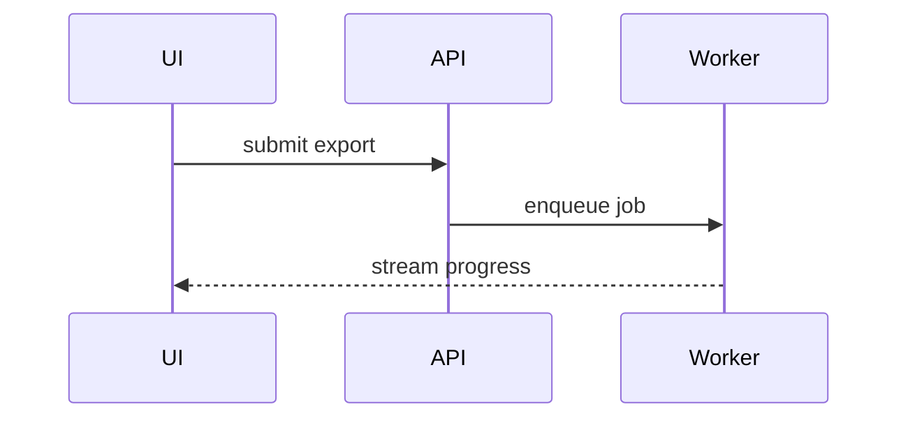

# Visuals for the PR body

Hold only the files, calls, props, states and boundaries the point needs. The change is the
point, so the default is a fenced `diff` over the shape that already exists; the whole shape, as
`text`, only when most of it is new.

A move, a split, or who owns what — a shallow file tree:

```diff
 src/
 ├── commands/
+│   └── export.ts        # parses the export flags
 ├── sessions/
-└── transport.ts
+└── transport/
+    ├── client.ts
+    └── stream.ts
```

A reordered or extended call chain — a call tree:

```diff
 submitForm
   createSession
     persistPrompt
+    validateAttachments
     launchJob
-  navigateToSession
+  navigateToSession
+    subscribeToEvents
```

UI structure, with the state hooks and module boundaries that matter — a component tree:

```diff
 <SessionPage>              (apps/web/src/routes/session.tsx)
   useSessionEvents()
   <SessionToolbar>
+    <ExportButton />       (packages/ui)
   <SessionTimeline>
+    <ExportResultCard />
```

Changed logic or state handling — pseudocode:

```diff
 on(save)
-  write content
+  if content is unchanged
+    return cached result
+  write new content
+  invalidate cache
```

Interaction across parts, or a data flow — a Mermaid sequence or flow diagram, on a forge that
renders Mermaid (e.g. GitHub, GitLab); elsewhere, a call tree:


